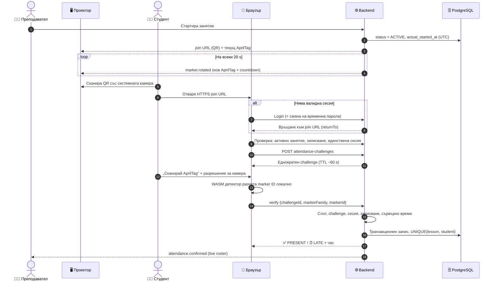
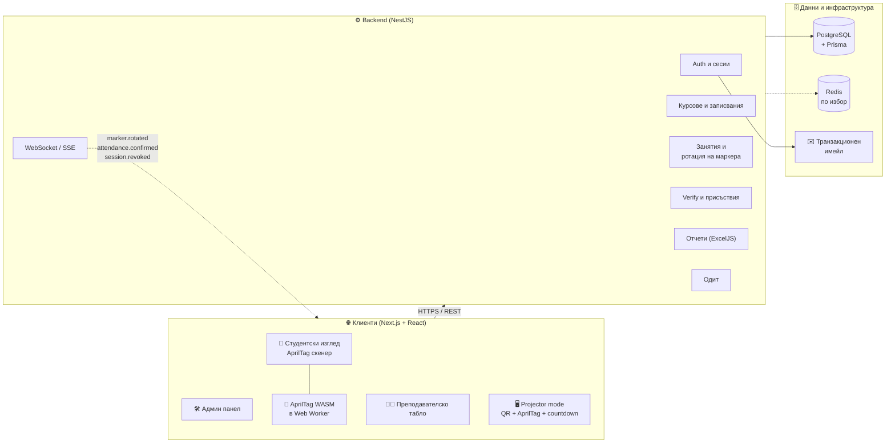
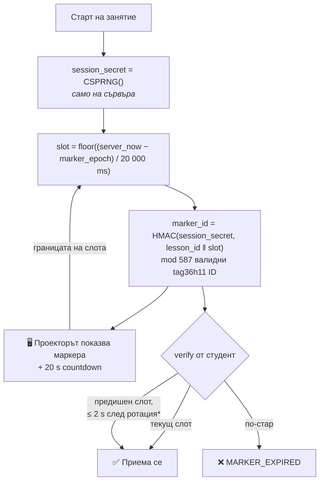
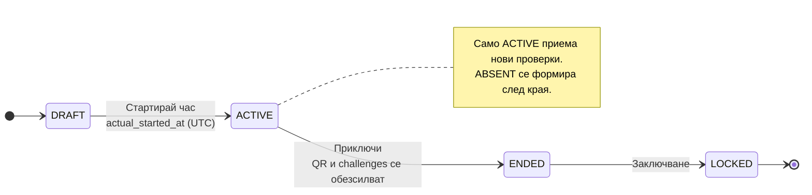
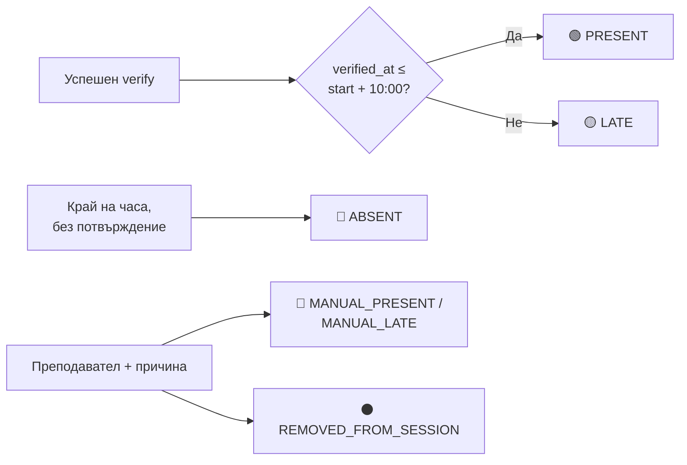
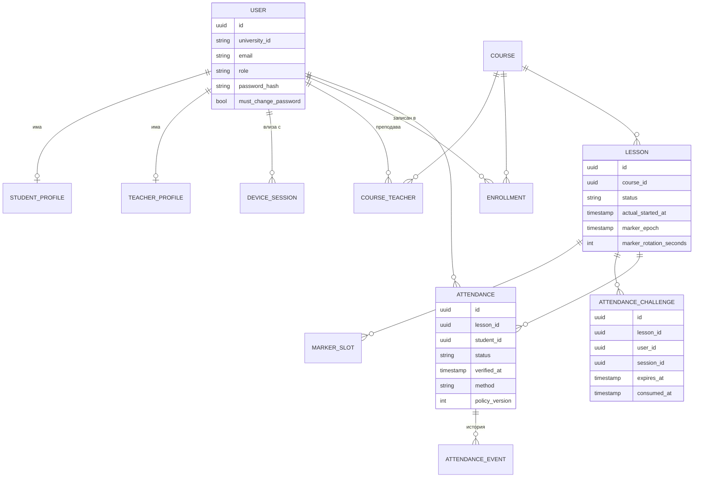
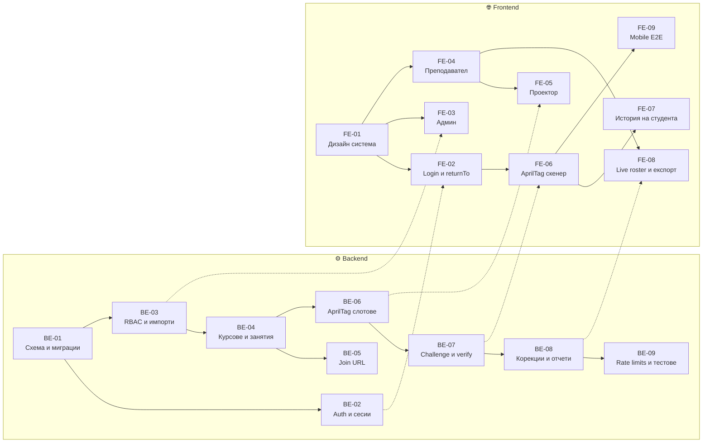
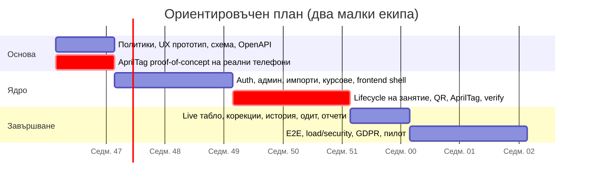

<div align="center">

# 🎓 Pamukkale University Attendance Platform

**Университетска уеб платформа за отчитане на присъствие с QR вход и AprilTag проверка от живата камера**


[Как работи](#-как-работи) •
[Архитектура](#-архитектура) •
[Правила](#-бизнес-правила) •
[API](#-api) •
[Backlog](#-backlog) •
[План](#-план-за-изпълнение)

</div>

---

> [!NOTE]
> Проектът е във фаза **спецификация**. Пълният документ е
> [`University_Attendance_Platform_FINAL_BG_v2_1.docx`](University_Attendance_Platform_FINAL_BG_v2_1.docx).
> При противоречие има предимство раздел 18 „Финален и задължителен потребителски поток“ (FINAL 2.0, 17.11.2026).

## 📌 Накратко

| | |
|---|---|
| 🎯 **Цел** | Достоверно отчитане на присъствие в университетски занятия |
| 👥 **Роли** | Администратор, преподавател, студент |
| 📷 **Проверка** | Етап 1: QR със системната камера → Етап 2: AprilTag 36h11 от живата браузърна камера |
| 🔄 **Ротация** | Маркерът се сменя на всеки **точно 20 секунди** по сървърно време |
| ⏱️ **Закъснение** | `verified_at ≤ start + 10:00` → **PRESENT**, иначе → **LATE** |
| 📱 **Сесии** | Студентът има само **една активна сесия**, новият вход прекратява старата |
| 🔒 **Поверителност** | Без съхранение на снимки, видео или биометрия. Разпознаването е локално в браузъра |
| 📊 **Отчети** | Excel (.xlsx) отчети по курс, седмица и занятие за преподавателите |

> [!WARNING]
> **Какво системата НЕ гарантира.** QR кодът сам не доказва присъствие. AprilTag ID не е тайна
> и не е криптографски подпис. 20-секундната ротация затруднява използването на стари снимки,
> но **не спира** живо препредаване, виртуална камера или подправен клиент. Платформата е
> *допълнителна проверка на присъствие*, а не доказателство за физическо местоположение.

---

## 🧭 Как работи

### Двата скенера са различни

| Етап | Камера | Какво прави | Какво НЕ прави |
|---|---|---|---|
| **1. QR** | Системното приложение „Камера“ на iOS/Android | Отваря HTTPS адреса на активното занятие | Не отчита присъствие, няма вграден QR скенер в сайта |
| **2. AprilTag** | Браузърна камера (`getUserMedia`, HTTPS) | Разпознава локално текущия маркер от жив видеопоток | Няма качване на файл, снимане или запис на кадри |

### Поток на студента



---

## 🏗️ Архитектура

Модулен монолит за MVP, без микросървиси. TypeScript навсякъде, за да се споделят типове, схеми и API договори между двата екипа.



### Технологичен стек

| Слой | Технология | Защо |
|---|---|---|
| Език | **TypeScript** (frontend и backend) | Общи типове и API договори |
| Frontend | Next.js, React | Един UI за трите роли, routing |
| UI | Tailwind CSS, shadcn/ui, React Hook Form, Zod | Бърза и последователна разработка |
| Data fetching | TanStack Query | Кеширане, refetch, optimistic updates |
| Backend | NestJS | Модули, guards, OpenAPI, WebSocket |
| База | PostgreSQL + Prisma | Релационна цялост и миграции |
| Real-time | WebSocket (Socket.IO) / SSE | Live roster, ротация, revoke |
| Опашки и кеш | Redis + BullMQ (по избор) | Имейли, импорти, rate limiting |
| QR | `qrcode` (npm) | Само генериране, сканира системната камера |
| Разпознаване | AprilTag 3 → WASM + TypeScript wrapper | Локална детекция, без AI модел |
| Отчети | ExcelJS | Сървърно генериране на .xlsx |
| Сигурност | Argon2id, HttpOnly cookies, CSRF, CSP, RBAC | |
| Тестове | Vitest/Jest, Supertest, Playwright, реални устройства | Unit, integration, E2E |
| Infra | Docker, CI/CD, S3-съвместим backup, мониторинг | Повторяемо разгръщане |

---

## 🔄 Ротация на AprilTag маркера



<sub>* Grace period от 2 секунди е конфигурируема политика, само ако опитът е започнал преди границата, и се одитира.</sub>

**Инварианти:**
- `session_secret` никога не стига до QR, HTML или клиентски JavaScript.
- Студентът не може да избира `marker_id`. Повторно използван challenge се отказва дори ако маркерът още е активен.
- При загуба на връзка проекторът показва „Проверката е временно недостъпна“ вместо стар маркер.
- При пауза или край на занятието маркерът, QR и всички challenges се обезсилват веднага.

---

## 📐 Бизнес правила

### Жизнен цикъл на занятие



### Статуси на присъствие



| Сценарий | Резултат |
|---|---|
| Verify в 10:00:00 след старта | **PRESENT** |
| Verify в 10:00:01 след старта | **LATE** |
| QR в 09:59, потвърждение в 10:01 | **LATE**. QR сканирането не „замразява“ статуса |
| Часовникът на телефона е грешен | Без ефект, важи само сървърното време |
| Два едновременни verify | Един запис, вторият връща същия резултат |
| Нов login от друг телефон | Старата сесия и нейните challenges стават невалидни (`SESSION_REVOKED`) |
| Студентът е отписан по време на сканиране | `ENROLLMENT_REVOKED`, не се създава присъствие |

### Роли и права

| Действие | 🛠️ Админ | 👩‍🏫 Преподавател | 🧑‍🎓 Студент |
|---|:-:|:-:|:-:|
| Управление на потребители и роли | ✅ | ❌ | Само собствен профил |
| Импорт и записване в курс | ✅ | Само свои курсове | ❌ |
| Създаване и стартиране на занятие | По политика | ✅ свои курсове | ❌ |
| QR и маркер | Преглед | ✅ показва | Сканира |
| Корекция на присъствие | ✅ + причина | ✅ свои занятия + причина | Само заявка |
| Справки | Общи | Свои курсове | Лични |
| Excel отчети | ✅ | ✅ свои курсове | ❌ |

---

## 🗃️ Модел на данните



Пълните полета, включително `AuditLog`, `MarkerSlot` и `DeviceSession`, са в раздели 3 и 16.6 на спецификацията.

---

## 🔌 API

<details>
<summary><b>Минимални маршрути (раздел 19.2)</b></summary>

| Група | Маршрути |
|---|---|
| **Auth** | `POST /auth/login` · `POST /auth/logout` · `POST /auth/change-password` · `POST /auth/activate` · `GET /auth/me` |
| **Админ** | `POST /admin/users/import/preview` · `POST /admin/users/import/commit` · `GET/PATCH /admin/users/:id` |
| **Курсове** | `POST /courses` · `PATCH /courses/:id` · `POST /courses/:id/enrollments` · `DELETE /courses/:id/enrollments/:studentId` |
| **Занятия** | `POST /lessons` · `POST /lessons/:id/start` · `POST /lessons/:id/end` · `GET /lessons/:id/display-state` |
| **Вход в час** | `GET /join/:joinToken` · `GET /api/join/:joinToken/context` · `POST /lessons/:id/attendance-challenges` |
| **Присъствие** | `POST /lessons/:id/attendance/verify` · `GET /me/attendance` · `GET /lessons/:id/attendance` |
| **Корекции** | `PATCH /lessons/:id/attendance/:studentId` · `POST /attendance/:id/disputes` · `GET /audit-events` |
| **Отчети** | `GET /teacher/courses/:courseId/reports/attendance.xlsx` · `GET /teacher/reports/weekly.xlsx` · `GET /teacher/sessions/:sessionId/report.xlsx` |
| **Събития** | `marker.rotated` · `lesson.ended` · `attendance.confirmed` · `auth.session.revoked` |

Всеки endpoint има RBAC и ownership guards, валидация (Zod/DTO), rate limits, стабилен код на грешка, `request_id` и OpenAPI схема. `Idempotency-Key` е задължителен при verify, import commit и старт на занятие.

</details>

<details>
<summary><b>Стандартни кодове на грешки (раздел 19.3)</b></summary>

| Код | Реакция в UI |
|---|---|
| `LOGIN_REQUIRED` | Запазва безопасен `returnTo` и отваря login |
| `SESSION_REVOKED` | Спира скенера, изисква нов login |
| `CAMERA_DENIED` / `CAMERA_UNAVAILABLE` / `INSECURE_CONTEXT` | Инструкции, без фалшив success |
| `MARKER_NOT_FOUND` | Насочване към дъската |
| `MARKER_EXPIRED` | „Насочете камерата към новия маркер“ |
| `CHALLENGE_EXPIRED` / `CHALLENGE_USED` | Нов challenge, без дублирано присъствие |
| `LESSON_ENDED` / `STUDENT_NOT_ENROLLED` / `STUDENT_REMOVED` | Блокирано удостоверяване с ясна причина |
| `NETWORK_OFFLINE` / `SERVER_TIMEOUT` | Retry с идемпотентен ключ, без success без сървърен ACK |

</details>

---

## 📊 Excel отчети

| Отчет | Съдържание |
|---|---|
| **RPT-01** Присъствия по курс | Всички записани студенти × всички занятия за избран период |
| **RPT-02** Седмица | Приключилите занятия за седмицата (пон–нед), групирани по курс |
| **RPT-03** Едно занятие | Записаните студенти, статус и час на потвърждение |

Всеки файл има листове **Обобщение**, **По студенти**, **По занятия** и **Детайли**.

```
Процент присъствие = (навреме + закъснели) / проведени занятия, за които студентът е бил записан × 100
```

Ако знаменателят е 0, се показва „Н/П“. Отменените занятия не се броят. Има защита срещу formula injection, а във файла няма пароли, токени, AprilTag ID или IP адреси.

---

## 🔐 Сигурност и поверителност

- 🚫 **Без снимки, видео или биометрични шаблони.** Разпознаването е локално, към сървъра отива само marker ID.
- 🔑 **Пароли:** Argon2id, покана с еднократен линк за активация, задължителна смяна на временна парола, MFA за админи и преподаватели.
- 🍪 **Сесии:** Secure/HttpOnly/SameSite cookies, ротационен refresh token, CSRF защита, CSP, HTTPS, revocation.
- 🛡️ **Права:** RBAC на всяка заявка. Преподавателят вижда само свои курсове, студентът само своите данни.
- 📝 **Одит:** корекции и премахвания не изтриват история, всяка промяна има actor и причина.
- ⚖️ **GDPR:** университетът определя правното основание и сроковете за съхранение. Препоръчва се DPIA.

---

## ✅ Backlog



<details>
<summary><b>Пълен списък със задачи (раздели 20 и 22.5)</b></summary>

**Frontend**

- [ ] **FE-01** Дизайн система, responsive layout, accessibility, навигация по роли
- [ ] **FE-02** Login, activation, задължителна смяна на парола, безопасен `returnTo` след QR
- [ ] **FE-03** Админ: потребители, CSV/XLSX preview и импорт, курсове и права
- [ ] **FE-04** Преподавател: курсове, записване и отписване, старт и край на час, проекторен екран
- [ ] **FE-05** Проектор: QR URL, AprilTag 36h11, 20 s countdown, WebSocket resync
- [ ] **FE-06** Студент: join страница, проверка на курса, AprilTag скенер, състояния за разрешения и грешки
- [ ] **FE-07** Студент: история, статуси, лични данни, заявки за корекция
- [ ] **FE-08** Преподавател: live roster, ръчни корекции с причина, експорт
- [ ] **FE-09** E2E на mobile Safari/Chrome: камера, завъртане, закъснение, смяна на сесия
- [ ] **FE-10** Екран „Присъствия и отчети“ с филтри и „Изтегли Excel“
- [ ] **FE-11** Седмичен изглед „Последни занятия“
- [ ] **FE-12** Изтегляне на .xlsx и обработка на 401/403/404/429/500

**Backend**

- [ ] **BE-01** Схема и миграции: users, roles, courses, enrollments, lessons, attendance, challenges, sessions, audit
- [ ] **BE-02** Auth, activation и временна парола, Argon2id, една активна сесия, revocation
- [ ] **BE-03** RBAC по курс и занятие, админ импорти с валидация
- [ ] **BE-04** CRUD за курсове, записвания и занятия, start/end и сървърни времена
- [ ] **BE-05** Генериране и валидация на join token, безопасен redirect
- [ ] **BE-06** 20 s слотове за AprilTag, сървърно време, display-state, WebSocket
- [ ] **BE-07** Еднократни challenges, атомарна проверка, статус на присъствие, unique constraints
- [ ] **BE-08** Корекции, заявки, одит, справки и експорти
- [ ] **BE-09** Rate limiting, мониторинг, политика за съхранение, integration/load/security тестове
- [ ] **BE-10** Агрегиране по курс, занятие и седмица
- [ ] **BE-11** XLSX генератор с ExcelJS (четири листа)
- [ ] **BE-12** Трите endpoint-а за отчети, права и одит на експортите

**QA**

- [ ] **QA-01** Contract, E2E, сигурност, конкурентност, матрица от устройства
- [ ] **QA-10** Отчети: нулеви занятия, отменен час, DST, 1000+ студенти, formula injection

</details>

---

## 🗓️ План за изпълнение



| Milestone | Резултат |
|---|---|
| **M1** | Схема, OpenAPI договор, mock отговори, дизайн на основните екрани |
| **M2** | Админ, курсове, auth, QR deep link със запазване на `returnTo` |
| **M3** | Проектор и AprilTag WASM прототип на реални iOS/Android устройства, измерен detection rate |
| **M4** | Атомарен verify, праг за закъснение, live roster, състояния на грешки |
| **M5** | Pentest и privacy преглед, достъпност, performance тест, deployment, документация |

> [!IMPORTANT]
> Най-големият риск е надеждното разпознаване на прожектирания маркер на различни телефони и при различна светлина. Технически proof-of-concept се прави още през първата седмица.

### Цели за пилота

| Метрика | Цел |
|---|---|
| Едновременни сканирания | 200 за 2 минути |
| p95 на verify API | < 500 ms (без CV на устройството) |
| Наличност | 99.5% |
| Браузъри | iOS Safari, Android Chrome, desktop Chrome/Edge/Firefox |
| Достъпност | WCAG 2.2 AA |

---

## ❓ Отворени решения

Тези въпроси трябва да се одобрят преди разработката (раздели 15 и 21):

- [ ] Интеграция с университетска система (SSO, LDAP, SIS) или самостоятелна система?
- [ ] Може ли преподавател да създава курсове свободно или само в рамките на факултет/семестър?
- [ ] Има ли лимит за закъснение, след който студентът е ABSENT вместо LATE?
- [ ] Корекции след LOCKED: разрешени ли са и кой ги одобрява?
- [ ] Процедура при липса на камера, смартфон или при увреждания?
- [ ] Един активен телефон или едно устройство от всякакъв тип? Какво става при загубен телефон?
- [ ] Колко дълго се пазят присъствията, логовете и заявките за корекция?
- [ ] Какъв е реалният мащаб и колко занятия текат едновременно?

---

<div align="center">
<sub>Pamukkale University • Attendance Platform • Спецификация FINAL 2.0</sub>
</div>
